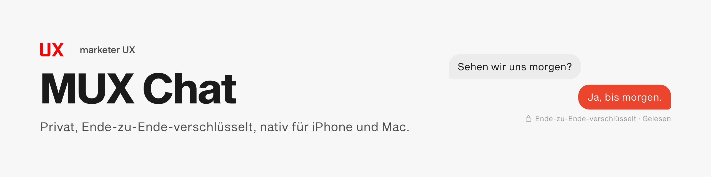
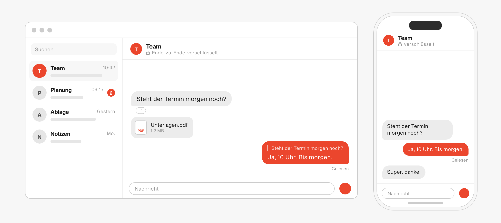

  <picture>
    <source media="(prefers-color-scheme: dark)" srcset=".github/assets/banner-dark.png">
    
  </picture>

  <a href="https://marketer-ux.com/kontakt">
    <picture>
      <source media="(prefers-color-scheme: dark)" srcset=".github/assets/get-in-touch-dark.png">
      
    </picture>
  </a>

# Chat

Chat-Bibliothek für SwiftUI, angepasst und gepflegt von [marketer UX](https://marketer-ux.com) für **MUX Chat**, unseren eigenen Messenger für iPhone und Mac.

MUX Chat ist ein privater Messenger mit Ende-zu-Ende-Verschlüsselung. Wir haben ihn von Grund auf nativ in SwiftUI gebaut. Diese Bibliothek liefert dafür die Chat-Oberfläche.

  <picture>
    <source media="(prefers-color-scheme: dark)" srcset=".github/assets/iphone-mac-dark.png">
    
  </picture>

## Was MUX Chat kann

- **Ende-zu-Ende-verschlüsselt:** Nachrichten, Bilder und Dateien werden auf dem Gerät verschlüsselt. Der Server sieht nur unlesbare Daten.
- **Nativ für iPhone und Mac:** zwei eigene SwiftUI-Apps statt einer Web-Hülle, mit einem gemeinsamen Kern.
- **Einzelchats und Gruppen:** neue Mitglieder sehen den Verlauf nur, wenn er für sie freigegeben wird.
- **Sicherheitsnummer mit QR-Code:** Gesprächspartner können ihre Schlüssel gegenseitig prüfen. Ändert sich ein Schlüssel, weist die App darauf hin.
- **App-Sperre und Bildschirmschutz:** Zugang per Code, Schutz vor Bildschirmfotos je Chat schaltbar.
- **Anmeldung mit zweitem Faktor:** Konto zusätzlich per Authenticator-App geschützt.
- **Schnell im Alltag:** Antworten per Wischen, Reaktionen, Zitieren, Weiterleiten, Anheften, Bearbeiten und Löschen.
- **Bilder, Videos und Dokumente:** verschlüsselt versendet, am Mac auch per Ziehen und Einfügen.
- **Gelesen-Abgleich zwischen Geräten:** was auf dem iPhone gelesen ist, gilt auch am Mac, inklusive Ungelesen-Zähler.
- **Offline lesen:** der Verlauf liegt verschlüsselt auf dem Gerät und ist auch ohne Netz verfügbar.
- **Selbstlöschende Nachrichten und Export:** Nachrichten verfallen auf Wunsch, Chats lassen sich passwortgeschützt exportieren.

## Diese Bibliothek

In MUX Chat zeichnet diese Bibliothek den Nachrichtenverlauf, die Eingabezeile, Anhänge, Antworten und Reaktionen. Verschlüsselung, Speicherung und Abgleich liegen in der App selbst. Die Bibliothek bleibt dadurch frei von einem bestimmten Server.

Unsere Anpassungen gegenüber dem Ausgangsstand:

- Fokus des Eingabefelds von außen steuerbar, damit nach dem Wischen zum Antworten sofort geschrieben werden kann
- Schriften für Uhrzeit, Absendername und Antwort-Zitat von außen setzbar

Zweige:

| Zweig | Inhalt |
|---|---|
| `mux-schrift` | Stand, den die MUX-Chat-App verwendet |
| `mux-fokus` | Vorgängerstand (nur die Fokus-Anpassungen) |
| `main` | diese Projektseite |

## Kontakt

Sie planen eine eigene App, einen sicheren Messenger oder eine Website? Sprechen Sie uns an: [marketer-ux.com/kontakt](https://marketer-ux.com/kontakt)

## Lizenz

MIT, siehe [LICENSE](LICENSE).
